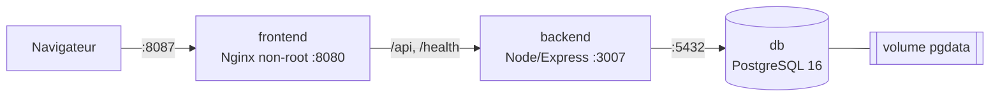

# Quiz App – Réalisation du groupe

## Architecture locale



Seul le frontend est exposé sur l'hôte. Le backend et la base ne sont joignables que sur le réseau interne Docker.

## Lancement local

```bash
cp .env.example .env      # puis adapter les valeurs
docker compose up -d --build
```
- Quiz : http://localhost:8087
- Admin : http://localhost:8087/gestion-quiz

## Choix techniques (J1)

| Élément | Choix | Raison |
|---|---|---|
| Backend | `node:20-alpine`, `USER node`, `tini` | Image légère, pas de root, arrêt propre (Node en PID 1 ignore SIGINT) |
| Frontend | Multi-stage : build Vite → `nginx-unprivileged` | Image finale sans Node ni sources, Nginx non-root (port 8080) |
| Base | `postgres:16-alpine` + volume `pgdata` | Persistance des données |
| Schéma | `init.sql` monté dans `/docker-entrypoint-initdb.d/` | Exécuté uniquement au 1er démarrage (volume vide) |
| Démarrage | `healthcheck` + `depends_on: service_healthy` | Le backend attend que Postgres soit prêt |

## Problèmes rencontrés

- **Ctrl+C n'arrêtait pas le backend** : Node en PID 1 ignore SIGINT. Corrigé avec `tini`.
- **Le backend plante sans `RESEND_API_KEY`** (`Missing API key`) : la variable doit toujours être fournie, une valeur factice suffit si l'envoi d'emails n'est pas configuré.

## Persistance

Test : création d'un résultat → `docker compose down` (sans `-v`) → `docker compose up -d` → le résultat est toujours présent. Voir `preuves/J1/`.

## Usage de l'IA

Claude (Anthropic) a été utilisé pour expliquer des notions (multi-stage, PID 1, volumes), proposer une première version des Dockerfiles et du Compose, et aider au diagnostic. Chaque proposition a été testée localement (build, `/health`, test de persistance) et adaptée.